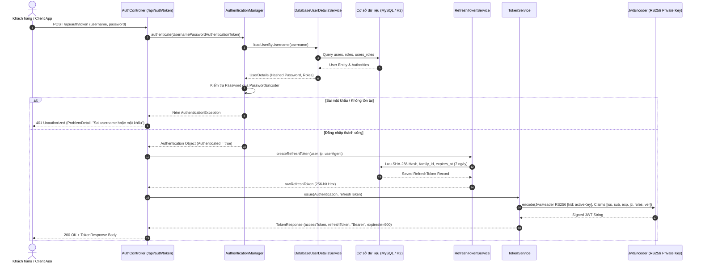
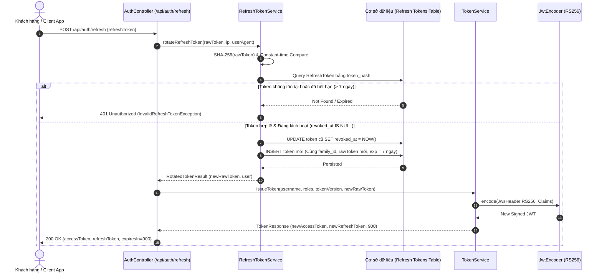
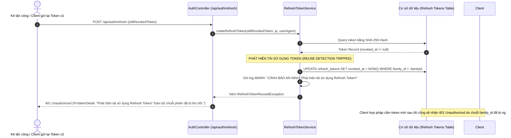

# Spring Security 7 JWT Catalog REST API & OAuth2 Resource Server

Dự án triển khai giải pháp xác thực và phân quyền tập trung chuẩn **OAuth2 Resource Server** dựa trên **Spring Boot 4.1.2**, **Spring Security 7.1.x**, và **Java 25 (LTS)**. Ứng dụng hoạt động theo kiến trúc **Stateless Architecture**, bảo vệ REST API bằng chuẩn **JSON Web Token (JWT)** với chữ ký bất đối xứng **RSA (RS256)**, hỗ trợ cơ chế quản lý phiên nâng cao gồm **Refresh Token Rotation**, **Phát hiện tái sử dụng Refresh Token (Reuse Detection)**, **Đăng xuất đơn (Single Logout)**, **Đăng xuất toàn bộ thiết bị (SLO)**, **Xoay khóa ký (JWKS Key Rotation)**, và **Giới hạn tần suất (Rate Limiting 429)**.

---

## 1. Kiến Trúc & Sơ Đồ Trình Tự (Sequence Diagrams)

### 1.1 Luồng 1: Cấp Token Lần Đầu (Initial Token Issuance)

Client gửi thông tin `username`/`password` đến `POST /api/auth/token`. Hệ thống kiểm tra thông tin, tạo phiên Refresh Token (lưu bản băm SHA-256) và cấp Access Token JWT (RS256) với TTL 15 phút.



---

### 1.2 Luồng 2: Refresh Token Có Xoay Vòng (Token Refresh with Rotation)

Mỗi khi Access Token sắp hết hạn, Client gửi Refresh Token hiện tại đến `POST /api/auth/refresh`. Hệ thống xác thực chuỗi băm SHA-256, đánh dấu token cũ là đã thu hồi (`revoked_at = NOW()`), và phát hành cặp Access Token + Refresh Token mới trong cùng `family_id`.



---

### 1.3 Luồng 3: Phát Hiện Dùng Lại Refresh Token (Reuse Detection)

Nếu một Refresh Token cũ đã bị thu hồi/xoay vòng trước đó được gửi lại (dấu hiệu rò rỉ token hoặc bị kẻ xấu đánh cắp), cơ chế **Reuse Detection** lập tức được kích hoạt để vô hiệu hóa **toàn bộ chuỗi token** có cùng `family_id`.



---

## 2. Hướng Dẫn Cấu Hình & Xoay Khóa Ký (Key Rotation)

### 2.1 Cấu trúc Cặp Khóa RSA
Hệ thống sử dụng khóa bất đối xứng RSA 2048-bit tiêu chuẩn, lưu trữ dưới dạng PEM tại thư mục `src/main/resources/keys/`:
- `catalog-key-2.key` / `catalog-key-2.pub`: **Active Key** hiện tại dùng để ký cấp phát Access Token mới.
- `catalog-key-1.key` / `catalog-key-1.pub`: **Old Key** (khóa cũ) dùng trong giai đoạn chuyển tiếp; các Token đã ký bằng khóa này vẫn được chấp nhận hợp lệ khi kiểm tra tài nguyên.

### 2.2 Quy Trình Xoay Khóa (Key Rotation Lifecycle)
1. **Khởi tạo khóa mới**: Sử dụng `com.fptaptech.catalog.util.RsaKeyGenerator` hoặc `openssl genpkey -algorithm RSA -pkeyopt rsa_keygen_bits:2048` để sinh cặp khóa mới (ví dụ: `catalog-key-3`).
2. **Cập nhật danh mục khóa trong `JwkKeyManager`**:
   - Thêm public key mới vào `JWKSet`.
   - Đặt `app.jwt.active-kid=catalog-key-3` trong `application.yaml`.
3. **Hiệu lực Stateless**:
   - Token mới sinh ra sẽ tự động mang header `{"kid": "catalog-key-3", "alg": "RS256"}` và được ký bằng Private Key mới.
   - Resource Server tra cứu public key tương ứng trong JWKS (`GET /.well-known/jwks.json`). Cả khóa cũ và khóa mới đều hợp lệ.
   - Khi token có `kid` lạ không nằm trong danh sách public key, hệ thống trả về mã lỗi `401 Unauthorized` kèm header `WWW-Authenticate: Bearer error="invalid_token"`.

---

## 3. Hướng Dẫn Khởi Chạy & Kiểm Thử

### 3.1 Khởi Chạy Ứng Dụng
```bash
./mvnw spring-boot:run
```
- **Trang chủ & Bảng điều khiển Playground UI**: [http://localhost:8080/](http://localhost:8080/)
- **Swagger UI Tài liệu API**: [http://localhost:8080/swagger-ui.html](http://localhost:8080/swagger-ui.html)
- **OpenAPI Schema (JSON)**: [http://localhost:8080/v3/api-docs](http://localhost:8080/v3/api-docs)
- **OpenAPI Schema (YAML File)**: [`docs/api/openapi.yaml`](docs/api/openapi.yaml)
- **JWKS Endpoint**: [http://localhost:8080/.well-known/jwks.json](http://localhost:8080/.well-known/jwks.json)

### 3.2 Tài Khoản Mặc Định
| Username | Mật khẩu | Quyền hạn (Roles) |
| :--- | :--- | :--- |
| `admin` | `DefaultAdminPass2026` | `ROLE_ADMIN`, `ROLE_USER` |
| `user` | `UserPass2026` | `ROLE_USER` |

### 3.3 Chạy Bộ Test Tự Động Toàn Diện
Bộ test tự động chứng minh 100% tất cả các yêu cầu bảo mật:
```bash
./mvnw test
```

### Danh Mục 17 Ca Kiểm Thử Tự Động (Tất cả đã Pass)
1. `validCredentialsReturnSignedToken`: Đăng nhập đúng trả về Token chứa roles `ROLE_USER`, `ROLE_ADMIN`.
2. `wrongPasswordReturnsProblemDetail`: Đăng nhập sai mật khẩu trả về 401 dạng `ProblemDetail` (RFC 7807).
3. `anyoneCanReadProducts`: Public client xem danh sách sản phẩm thành công không cần token (200 OK).
4. `writeWithoutTokenReturns401WithBearerChallenge`: Gửi `POST /api/v1/products` không kèm Token trả về 401 kèm header `WWW-Authenticate`.
5. `userRoleCannotCreateProduct`: Token mang `ROLE_USER` gửi `POST /api/v1/products` bị chặn bởi 403 Forbidden.
6. `adminRoleCanCreateProduct`: Token mang `ROLE_ADMIN` gửi `POST /api/v1/products` tạo mới thành công (201 Created).
7. `malformedTokenIsRejected`: Token biến dạng / sai chữ ký bị từ chối với 401.
8. `serviceRejectsNonAdminEvenWithoutHttp`: Phòng thủ 2 lớp - gọi trực tiếp Java service `ProductService.create()` mà không có `ROLE_ADMIN` bị ném `AccessDeniedException`.
9. `testSuccessfulRefreshTokenRotation`: Xoay vòng refresh token thành công, cấp Access Token mới + Refresh Token mới.
10. `testReusingOldRefreshTokenRevokesEntireFamilyChain`: Dùng lại refresh token cũ làm toàn bộ chuỗi cùng `family_id` bị thu hồi (Reuse Detection).
11. `testAccessTokenRejectedAfterLogout`: Access token bị từ chối ngay sau Single Logout (`jti` bị đưa vào danh sách thu hồi).
12. `testAllTokensRejectedAfterLogoutAll`: Mọi token bị từ chối sau Logout All (`token_version` được tăng lên).
13. `testAllTokensRejectedAfterPasswordChange`: Mọi token cũ bị từ chối sau khi người dùng đổi mật khẩu.
14. `testTokenSignedWithOldKeyStillAccepted`: Token ký bằng khóa cũ (`catalog-key-1`) vẫn được chấp nhận hợp lệ.
15. `testTokenWithUnknownKidRejected`: Token có `kid` lạ không xác định bị từ chối với 401.
16. `testEleventhRequestWithinOneMinuteReceives429`: Request thứ 11 trong vòng 1 phút nhận HTTP 429 Too Many Requests kèm header `Retry-After: 60`.
17. `exportOpenApiYaml`: Xuất đặc tả kỹ thuật API tự động ra tệp `docs/api/openapi.yaml`.

---

## 4. Giao Diện Người Dùng (Frontend Playground)
Giao diện người dùng được thiết kế với phong cách tươi sáng, trẻ trung, sử dụng gradient pastel chuyển động nhẹ nhàng, thẻ kính mờ (glassmorphism), typography hiện đại và bảng điều khiển trực quan hỗ trợ:
- Đăng nhập 1-click tài khoản Admin hoặc User.
- Giải mã trực tiếp JWT payload (Subject, Key ID, Token Version, Roles).
- Sao chép nhanh Access Token và Refresh Token.
- Thực thi thử nghiệm các API: Thông tin cá nhân, Duyệt sản phẩm, Tạo sản phẩm, Xoay vòng Refresh Token, Giả lập gửi lại token cũ (Reuse Detection), Đăng xuất đơn, Đăng xuất mọi thiết bị, Bắn 11 request liên tiếp mô phỏng Rate Limit 429.
- Live Terminal hiển thị phản hồi chuẩn RFC 7807, HTTP Status Badge và Latency thời gian thực.
