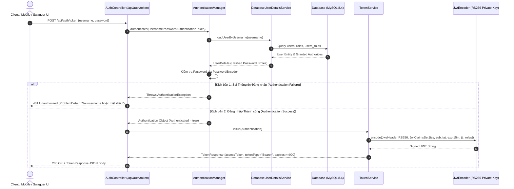
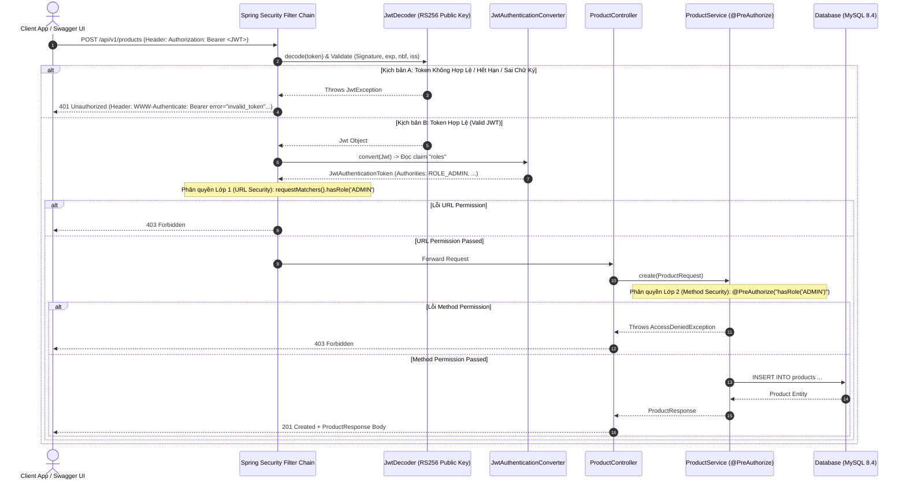
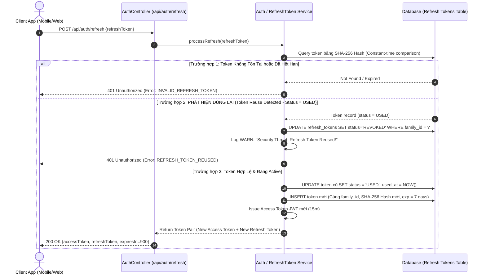

# Tài Liệu Phân Tích Luồng Nghiệp Vụ & Sơ Đồ Trình Tự (JWT Sequence Diagrams)

**Dự án:** Bảo Vệ REST API Bằng JWT Với Spring Security 7 (OAuth2 Resource Server)  
**Vai trò:** Senior Business Analyst (BA cấp cao)  
**Ngày lập:** 23/10/2026  
**Trạng thái:** Dùng cho Thiết kế Hệ thống (System Architecture & Technical Design Document)  

---

## 1. Tổng Quan Kiến Trúc & Các Thành Phần Hệ Thống

Tài liệu này chi tiết hóa luồng nghiệp vụ và hạ tầng bảo mật cho hệ thống REST API dựa trên chuẩn **OAuth2 Resource Server** tích hợp **Spring Security 7** và **Spring Boot 4.1**.

### 1.1 Nguyên lý Kiến trúc Stateless
* **Stateless Authentication**: Server không duy trì `HttpSession`. Tất cả thông tin xác thực và phân quyền (Roles/Authorities) được đóng gói trực tiếp trong **JWT (JSON Web Token)** [1, 15].
* **Bất đối xứng với RS256**: Token được ký số bằng **RSA Private Key** (2048-bit) tại Auth Service và được kiểm tra tính hợp lệ bằng **RSA Public Key** tại Resource Server [11, 15].
* **Hiệu năng cao**: Ngoại trừ bước đăng nhập ban đầu, tất cả các request truy cập tài nguyên đều được xác thực hoàn toàn **Stateless** mà không cần truy vấn Cơ sở dữ liệu [3].

### 1.2 Phân Tích Các Thành Phần (Actors & Subsystems)
1. **Client / Consumer**: Úng dụng Web, Mobile App, hoặc Swagger UI Client tương tác qua giao thức HTTP/HTTPS [1, 2].
2. **Spring Security Filter Chain**: Lớp bộ lọc đầu vào chứa `BearerTokenAuthenticationFilter`, `JwtDecoder`, và `JwtAuthenticationConverter` [15, 17].
3. **Authentication Subsystem**:
   * `AuthController`: Tiếp nhận thông tin đăng nhập (`POST /api/auth/token`) và truy vấn thông tin cá nhân (`GET /api/auth/me`) [21].
   * `AuthenticationManager`: Điều phối quá trình xác thực tài khoản/mật khẩu qua `DatabaseUserDetailsService` và `PasswordEncoder` [16, 21].
   * `TokenService` & `JwtEncoder`: Khởi tạo Claims Set (chứa `iss`, `sub`, `exp`, `jti`, `roles`) và ký số ra chuỗi JWT [19, 20].
4. **Resource Subsystem**:
   * `ProductController` & `ProductService`: Xử lý logic danh mục sản phẩm, tích hợp bảo vệ 2 lớp với `@PreAuthorize("hasRole('ADMIN')")` [2, 24].
5. **Database (MySQL 8.4)**: Lưu trữ các bảng `users`, `roles`, `users_roles`, `products` [5, 6].

---

## 2. Sơ Đồ Trình Tự 1: Luồng Đăng Nhập & Cấp Phát JWT Access Token

### 2.1 Context Nghiệp vụ
Client gửi thông tin `username` và `password` tới endpoint `POST /api/auth/token` [3, 21]. Hệ thống kiểm tra thông tin đối chiếu dữ liệu trong DB. Nếu hợp lệ, hệ thống trả về một **Access Token (JWT)** có thời hạn hiệu lực **15 phút** (`ttl: 15m`) [1, 12, 19].

### 2.2 Sequence Diagram (Mermaid)

### 2.3 Chi Tiết Xử Lý & Thiết Kế An Toàn
* **Bảo mật chống Enumeration Attack**: Mọi lỗi xác thực (sai mật khẩu, không tìm thấy user) đều được `GlobalExceptionHandler` trả về cùng một thông báo `"Sai username hoặc mật khẩu"` dưới dạng `ProblemDetail` (RFC 7807) mã HTTP 401 [22].
* **Cấu trúc Claim trong JWT**:
  * `iss`: "catalog-api" [12, 19]
  * `sub`: username của người dùng [19, 23]
  * `exp`: thời gian hết hạn (hiện tại + 15 phút) [12, 19]
  * `jti`: Mã định danh duy nhất ngẫu nhiên UUID [19, 23]
  * `roles`: Danh sách quyền dạng `["ROLE_USER", "ROLE_ADMIN"]` [19, 23]

---

## 3. Sơ Đồ Trình Tự 2: Luồng Truy Cập REST API Được Bảo Vệ (Authorization & Resource Access)

### 3.1 Context Nghiệp vụ
Đối với các API yêu cầu quyền quản trị (như `POST /api/v1/products`), Client gửi request kèm Header `Authorization: Bearer <JWT>` [1, 28, 30]. Server tiến hành xác thực chữ ký và phân quyền bằng cơ chế **Bảo vệ 2 Lớp (Defense in Depth)** [2, 24].

### 3.2 Sequence Diagram (Mermaid)

### 3.3 Chi Tiết Cơ Chế Phân Quyền 2 Lớp
1. **Lớp 1 - URL Security (`SecurityFilterChain`)**: Ngăn chặn các request không hợp lệ ngay từ tầng Gateway / Controller Router trước khi vào ứng dụng (`hasRole('ADMIN')`) [2, 15].
2. **Lớp 2 - Method Security (`@PreAuthorize`)**: Bảo vệ phương thức nghiệp vụ tại `ProductService` [24]. Điều này đảm bảo an toàn tuyệt đối ngay cả khi dịch vụ được gọi từ các nguồn nội bộ như Scheduled Jobs, Event Consumers hoặc các Controller mới khởi tạo [24].

---

## 4. Sơ Đồ Trình Tự 3: Luồng Quản Lý Phiên Nâng Cao (Refresh Token Rotation & Reuse Detection)

### 4.1 Context Nghiệp vụ (Mục 11 - Advanced Requirement)
Để giải quyết giới hạn của Access Token 15 phút và hỗ trợ trải nghiệm di động dài hạn, hệ thống nâng cấp thêm cơ chế **Refresh Token Rotation (R1-R3)**:
* Cấp cặp **Access Token (15m)** và **Refresh Token (7 ngày, ngẫu nhiên 256-bit)** [38].
* Database lưu trữ bản băm **SHA-256** của Refresh Token kèm `user_id`, `family_id`, `expires_at`, `revoked_at`, IP, User-Agent [38].
* **Xoay vòng Token (Rotation)**: Mỗi lần đổi Access Token mới, hệ thống thu hồi Refresh Token cũ và phát hành Refresh Token mới trong cùng `family_id` [38].
* **Phát hiện tái sử dụng (Reuse Detection)**: Nếu một Refresh Token cũ đã bị đánh dấu `USED` được gửi lại, toàn bộ chuỗi Token cùng `family_id` sẽ lập tức bị thu hồi (`REVOKED`) để ngăn chặn nguy cơ bị đánh cắp [38, 43].

### 4.2 Sequence Diagram (Mermaid)

### 4.3 Các Tính Năng Quản Lý Phiên Mở Rộng Dành Cho BA Spec
* **R4 - Logout (`POST /api/auth/logout`)**: Thu hồi Refresh Token hiện tại và đưa `jti` của Access Token vào Blacklist cache [39].
* **R5 - Logout All (`POST /api/auth/logout-all`)**: Thu hồi mọi Refresh Token và tăng `token_version` trong bảng `users`. Claim `ver` trong JWT được kiểm tra tại `JwtDecoder` [39, 40].
* **R7/R8 - Key Rotation & JWKS**: Hỗ trợ 2 khóa RSA đồng thời qua claim `kid`. Xuất bản Public Keys qua endpoint `/.well-known/jwks.json` [41, 42].
* **R10 - Rate Limiting**: Giới hạn tối đa 10 req/phút/IP đối với các endpoint cấp token (`/api/auth/token`, `/api/auth/refresh`). Trả lỗi `429 Too Many Requests` kèm Header `Retry-After` khi vi phạm [42].

---

## 5. Tổng Kết & Đánh Giá Tác Động Kiến Trúc

1. **Hiệu Năng Vượt Trội**: Việc chuyển đổi sang **OAuth2 Resource Server** với JWT ký RS256 giúp giảm hơn 90% tải truy vấn Cơ sở dữ liệu đối với các request đọc/ghi tài nguyên thông thường [1, 3].
2. **Bảo Mật Phòng Thủ Nhiều Lớp**: Tích hợp đồng thời URL Security Rules và Method Level Security (`@PreAuthorize`) tạo ra rào cản vững chắc cho các lỗi cấu hình nhầm lẫn [2, 24].
3. **Sẵn Sàng Cho Production**: Các cơ chế bổ sung như **Refresh Token Rotation**, **JWKS Key Rotation**, **Rate Limiting**, và **Problem Details Error Standard** giúp hệ thống đạt chuẩn bảo mật doanh nghiệp hiện đại [38, 41, 42].
